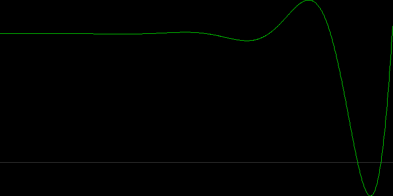

# AeroStable: Control System & Stability Analyzer

AeroStable is a C++23 application designed to simulate and visualize the stability of dynamic systems (like drones, robots, or self-driving cars). It uses advanced numerical methods to determine if a system is **Stable** or **Unstable** and visualizes its real-time response.

 <!-- Isme dono images side by side dikha sakte ho -->

## 🚀 Key Features
- **Polynomial Root Finding (Durand-Kerner):** Finds complex poles of any transfer function.
- **Pole-Zero Map:** Visualizes poles on the s-plane. Left (Green) = Stable, Right (Red) = Unstable.
- **Time-Domain Simulation (RK4):** Uses Runge-Kutta 4th Order integration to simulate how the system reacts to a step input over time.
- **Modern C++ (C++23):** Built entirely using C++23 Modules, advanced data structures, and custom PNG/PPM rendering.

## 🛠️ How it Works (The Math)
1. **The Math Engine:** Parses the system equation (e.g., `s^2 - 2s + 5`) and finds roots.
2. **Stability Criterion:** If any pole is in the Right-Half Plane (positive real part), the system is unstable.
3. **Time Simulation:** Generates an Ordinary Differential Equation (ODE) and solves it using RK4 to plot the response.

## 🏃‍♂️ Build & Run
Requires `Clang 17+`, `CMake 3.28+`, and `Ninja`.

```bash
cmake -S . -B build -G Ninja -DCMAKE_BUILD_TYPE=Release
cmake --build build -j
./build/aerostable